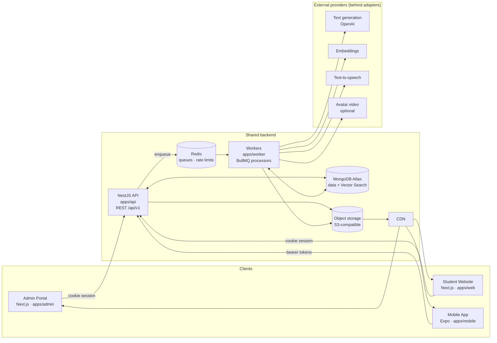

# 01 — System Architecture

## 1. Context



Only **apps/api** and **apps/worker** have database credentials. The frontends talk to the database only through the API.

## 2. Monorepo

**Tooling:** pnpm workspaces + Turborepo (task graph and caching). TypeScript `strict` everywhere.

```
cslp/
├─ apps/
│  ├─ admin/            Next.js App Router — Admin Portal
│  ├─ web/              Next.js App Router — Student Website (later prompt)
│  ├─ mobile/           Expo / React Native (later prompt)
│  ├─ api/              NestJS HTTP app: controllers, guards, request binding
│  └─ worker/           NestJS standalone app: BullMQ processors only
├─ packages/
│  ├─ server-core/      Domain layer shared by api + worker: Mongoose schemas,
│  │                    repositories, domain services, provider adapters, queue defs
│  ├─ validation/       Zod schemas: the single source of truth for every DTO
│  ├─ shared-types/     Types inferred from validation + enums (status, roles, permissions)
│  ├─ api-client/       Typed client + TanStack Query hooks generated from OpenAPI
│  ├─ video-templates/  Remotion compositions (rendered by worker, previewed in admin)
│  ├─ editor-schema/    TipTap/ProseMirror schema + JSON→HTML renderer (shared by
│  │                    admin editor, publish step, web, mobile)
│  ├─ design-tokens/    Colours, spacing, typography (CSS vars + TS + RN export)
│  ├─ ui/               Admin/web React component library (accessible primitives)
│  └─ config/           tsconfig, eslint, prettier, vitest/jest presets
├─ infrastructure/      docker-compose (local), Dockerfiles, IaC
└─ docs/
```

### Why `packages/server-core` exists

The brief asks for a separate `apps/worker`. The worker needs the same schemas, versioning rules, cost ledger and provider adapters as the API. If the worker imported from `apps/api`, the dependency would point the wrong way. Putting the domain in a package means:

- `apps/api` = transport (HTTP, auth guards, Swagger)
- `apps/worker` = transport (queues)
- `packages/server-core` = all business rules, written once

The student endpoints and admin endpoints in `apps/api` call the **same** domain services. Student visibility rules live in exactly one place: `PublishedContentQueryService` (see doc 05).

## 3. Technology choices

Versions were checked against npm on 2026-11-09. We pin exact versions when scaffolding and recheck compatibility (especially NestJS ↔ nestjs-zod ↔ @nestjs/swagger, and Expo ↔ React).

| Concern              | Choice                                                                                                                           | Latest major at check |
| -------------------- | -------------------------------------------------------------------------------------------------------------------------------- | --------------------- |
| Admin / web frontend | Next.js App Router, React, TypeScript                                                                                            | Next 16, React 19     |
| Styling              | Tailwind CSS + `packages/design-tokens`                                                                                          | Tailwind 4            |
| Forms                | React Hook Form + Zod resolver (same schemas the API uses)                                                                       | Zod 4                 |
| Server state         | TanStack Query (hooks generated into `api-client`)                                                                               | v5                    |
| Rich text            | TipTap (ProseMirror) + KaTeX math + lowlight code highlighting                                                                   | TipTap 3              |
| Charts               | Recharts                                                                                                                         | —                     |
| Backend              | NestJS + Mongoose                                                                                                                | Nest 12, Mongoose 9   |
| Validation / OpenAPI | In-house Zod integration (`apps/api/src/common/zod.ts`): validation pipe + Zod 4 `z.toJSONSchema` → `@nestjs/swagger` components | —                     |
| Client generation    | Orval (OpenAPI → typed fetchers + TanStack hooks)                                                                                | Orval 8               |
| Queues               | BullMQ on Redis 7                                                                                                                | BullMQ 6              |
| Video                | Remotion (`@remotion/renderer` in worker, `@remotion/player` in admin) + FFmpeg                                                  | Remotion 4            |
| Password hashing     | Argon2id                                                                                                                         | —                     |
| Search / RAG         | MongoDB Atlas Vector Search (local: `mongodb/mongodb-atlas-local` image)                                                         | —                     |
| Storage              | S3-compatible API (R2 / S3; SeaweedFS locally)                                                                                   | —                     |
| Tests                | Vitest (packages, frontend), Jest + Supertest (Nest), mongodb-memory-server / Testcontainers, Playwright (E2E)                   | —                     |
| Observability        | Pino structured logs, OpenTelemetry traces, Sentry                                                                               | —                     |

## 4. Runtime topology

| Process            | Scales on                                          | Notes                                                                                                                                                                       |
| ------------------ | -------------------------------------------------- | --------------------------------------------------------------------------------------------------------------------------------------------------------------------------- |
| `api`              | CPU / request rate                                 | Stateless. Horizontal. Never runs long work inline.                                                                                                                         |
| `worker:ai`        | Queue depth (`ai-text`, `embeddings`, `documents`) | Limited by provider rate limits, set per queue.                                                                                                                             |
| `worker:video`     | Queue depth (`video-render`)                       | Larger instances (4 vCPU / 8 GB), with Chromium + FFmpeg in the image. Concurrency 1–2 per instance. Can move to Remotion Lambda behind the same `VideoRenderer` interface. |
| `worker:scheduler` | Single instance                                    | Repeatable jobs: scheduled publishing, budget roll-ups, stuck-job reaper.                                                                                                   |
| `admin`, `web`     | Edge/serverless or containers                      | Talk to the API only.                                                                                                                                                       |

## 5. Request path (admin)

```
Browser ──(httpOnly cookie, CSRF header)──▶ Next.js admin (server components / route handlers)
        ──▶ NestJS /api/v1/admin/*
            1. RequestContext middleware (requestId, ip, ua)
            2. Throttler (Redis store)
            3. AuthGuard (JWT aud=admin, session not revoked, MFA satisfied)
            4. PermissionsGuard (@RequirePermission('course.update'))
            5. InstitutionScopeGuard (resolves target institution, checks the user's assignments)
            6. ZodValidationPipe
            7. Controller → domain service (TenantScope passed explicitly)
            8. AuditInterceptor (writes audit log for mutating calls)
            9. Response envelope interceptor
```

## 6. Architecture Decision Records

| ADR | Decision                                                                                                                                                                           | Reason                                                                                            | Rejected alternative                                                                     |
| --- | ---------------------------------------------------------------------------------------------------------------------------------------------------------------------------------- | ------------------------------------------------------------------------------------------------- | ---------------------------------------------------------------------------------------- |
| 001 | pnpm + Turborepo monorepo                                                                                                                                                          | Fast, strict dependency isolation, good Expo support (`node-linker=hoisted` for mobile if needed) | Nx (more than we need), npm workspaces (slower, looser)                                  |
| 002 | Domain logic in `packages/server-core`                                                                                                                                             | api and worker share logic without duplicating it                                                 | Worker importing from `apps/api`; one Nest app with two entrypoints (blurs deploy units) |
| 003 | **Zod-first contracts** (`packages/validation`). _Amended 2026-11-09:_ `nestjs-zod` does not support NestJS 12, so a ~100-line integration uses Zod 4's native JSON Schema output. | One schema drives API validation, OpenAPI, admin forms and mobile forms                           | class-validator DTOs (cannot be shared with React/RN)                                    |
| 004 | OpenAPI → Orval-generated `api-client`                                                                                                                                             | Web and mobile get typed clients for free. CI fails if the spec changes without regenerating.     | Hand-written client; tRPC (not REST, harder for mobile/third parties)                    |
| 005 | Separate `generationStatus` and `reviewStatus` on versions, plus `publication` state on the material                                                                               | Avoids impossible combinations like "published + generating" (doc 05)                             | One status enum                                                                          |
| 006 | Versions are immutable once submitted; materials hold `publishedVersionId`                                                                                                         | Gives rollback, reproducibility, and lets videos/quizzes pin their source version                 | Edit-in-place with a history table                                                       |
| 007 | No separate student "published" collection. All student reads go through one `PublishedContentQueryService`.                                                                       | Honours "no duplicate course collections" while keeping visibility rules in a single place        | Projection collections (duplicate data)                                                  |
| 008 | Canonical rich text = ProseMirror JSON. Sanitised HTML is rendered and frozen at publish time.                                                                                     | Safe structured editing. Mobile and web render the frozen HTML (or the JSON via `editor-schema`). | Markdown (weak for tables/math); raw HTML (XSS risk)                                     |
| 009 | AI returns **structured JSON** (schema-validated) that is converted deterministically into editor documents                                                                        | Validatable, citation-checkable, no prompt-injected HTML                                          | Asking the model for markdown/HTML                                                       |
| 010 | Atlas Vector Search for RAG, with `institutionId` + `courseId` as pre-filter fields                                                                                                | One database, tenant-safe retrieval                                                               | Separate vector DB (Pinecone etc.)                                                       |
| 011 | Remotion for deterministic video. Code and slide text are rendered as React components.                                                                                            | Accurate code and text, reproducible renders, preview in browser                                  | Text-to-video models (hallucinate text/code)                                             |
| 012 | Provider adapters + model routing by **task key** (`notes.comprehensive`, `quiz.mcq`, …) resolved from settings                                                                    | No model names in business logic; per-institution budgets                                         | Hardcoded model strings                                                                  |
| 013 | Admin auth: short-lived access JWT + rotating refresh token in httpOnly cookies, refresh-token family reuse detection, TOTP MFA (mandatory for Super/Institution Admin)            | Stronger than the student flow, as the brief requires                                             | localStorage tokens                                                                      |
| 014 | One `users` collection with `accountType: admin \| student`. JWT audiences separate them.                                                                                          | Simpler identity; student tokens are rejected on `/admin/*`                                       | Separate admin/student user collections                                                  |

## 7. Cross-cutting concerns

- **Tenancy:** every institution-owned document carries `institutionId`. Repositories need a `TenantScope` argument. A Mongoose plugin also throws in non-test environments if a query on a tenant-scoped model has no `institutionId` filter, unless it is explicitly marked `.setOptions({ crossTenant: true })` (Super Admin only). See doc 03 §4.
- **Idempotency:** mutating job endpoints accept an `Idempotency-Key` header. Generation jobs also derive a deterministic `dedupeKey` (doc 06 §7).
- **Secrets:** provider API keys live in a secret manager (AWS Secrets Manager / Doppler). If keys are stored in the database (per-institution BYO keys), they are AES-256-GCM encrypted with an envelope key from KMS and never returned by the API.
- **Data protection (NDPA 2023):** minimal student PII, a retention policy for AI conversations, export/delete endpoints for students, and admin access to student data is audit-logged.
- **Accessibility:** WCAG 2.2 AA for admin and web. Every drag-and-drop has keyboard "Move up/Move down" controls.

## 8. Implementation notes (recorded during Phase 1, 2026-11-09)

| Topic                    | Decision                                                                                                                                                                                                                                                                                                                                                                           |
| ------------------------ | ---------------------------------------------------------------------------------------------------------------------------------------------------------------------------------------------------------------------------------------------------------------------------------------------------------------------------------------------------------------------------------- |
| Module format            | NestJS 12 ships ESM-only, so `apps/api`, `server-core`, `validation` and `shared-types` are **native ESM** (`"type": "module"`, `NodeNext` resolution, `.js` import specifiers).                                                                                                                                                                                                   |
| TypeScript               | Pinned to **6.0.3**. TypeScript 7 (native compiler) is not yet supported by `@nestjs/swagger` or `typescript-eslint`.                                                                                                                                                                                                                                                              |
| Tests                    | Vitest everywhere. Nest packages use `unplugin-swc` because esbuild does not emit decorator metadata. Integration tests use `mongodb-memory-server` replica sets, so Docker isn't needed for CI.                                                                                                                                                                                   |
| Tenant plugin            | Enforced in **all** environments, including tests (stricter than the original §7 wording), so unscoped queries fail in CI.                                                                                                                                                                                                                                                         |
| Response contracts       | In non-production, every response with `@ApiOk(schema)` is validated against its Zod schema, so drift between code and contract fails tests.                                                                                                                                                                                                                                       |
| Ordering keys            | Small in-house fractional-index implementation (`server-core/src/database/order-key.ts`). The `fractional-indexing` package is ESM-only with no types path suitable for our build.                                                                                                                                                                                                 |
| Department-level scoping | `roleAssignments.departmentIds` is stored but not yet enforced. Enforcement arrives with courses in Phase 2, where departments first matter.                                                                                                                                                                                                                                       |
| Admin → API proxy        | `apps/admin/src/app/api/[...path]/route.ts` proxies `/api/*` **at request time** (reads `API_URL` per request). `next.config` rewrites were dropped because Next resolves their destinations at build time, which would tie a build to one environment.                                                                                                                            |
| UI components            | Admin primitives live in `apps/admin/src/components/ui` for now; they move to `packages/ui` when the student website starts, so the extraction follows real reuse. Colours come only from `packages/design-tokens`, and every text/background pair is WCAG AA in both themes (checked by axe in e2e).                                                                              |
| E2E                      | Playwright in `apps/admin/e2e` runs the built API + admin against Docker MongoDB with a throwaway database per run, including axe accessibility checks. `E2E_SCREENSHOTS=<dir>` saves key screens.                                                                                                                                                                                 |
| Uploads                  | Files go through the API (multipart, ≤ 50 MB, held in memory) instead of presigned browser PUTs, so content sniffing and malware scanning happen **before** anything is stored and no storage CORS is needed. Presigned uploads can be added for video assets in Phase 4.                                                                                                          |
| Local object storage     | SeaweedFS replaces MinIO (MinIO stopped publishing images in 2025). Same S3 API; production targets R2/S3.                                                                                                                                                                                                                                                                         |
| Job execution modes      | `QUEUE_MODE`: BullMQ via Redis (api + worker) or `inline` (in-process; tests and Redis-less dev). Processors live in `server-core` and are identical in both modes. BullMQ 6 needs constructed `ioredis` clients under ESM (`createRedis`).                                                                                                                                        |
| AI without a key         | With no `OPENAI_API_KEY`, outlines use deterministic layout detection (`method: heuristic`) and embeddings are skipped with a visible warning. With a key and `AI_MODEL_OUTLINE_EXTRACT`, structured AI extraction runs and every node's source quote is verified against the document text server-side.                                                                           |
| Student records (5b)     | Implemented as `enrolments`, `materialprogresses` and `quizattempts`, keyed by `userId` (the student's user id) and always filtered by the student's own `institutionId` (tenant plugin applies). Quiz attempts are `POST /student/materials/:id/attempts`: submission and grading happen in one step, graded against the pinned question revisions of the published quiz version. |
| Student identity (5b)    | Students are `users` with `accountType: 'student'`, `studentProfile { institutionId, programmeId?, levelId? }` and `emailVerifiedAt`. Verification and reset links use the `verificationtokens` collection (SHA-256 hashes, TTL). The admin portal hosts `/verify-email` and `/reset-password` until the student website exists (`STUDENT_APP_URL`).                               |
| Dashboard permission     | `GET /admin/dashboard/overview` requires `course.view` (held by every admin role) and is scoped to the caller's institutions. Engagement requires `analytics.view`; the student list requires `student.view`, and suspension requires `student.manage`.                                                                                                                            |
| Two-step verification    | At the product owner's request (2026-11-09), MFA is **optional** by default: `MFA_REQUIRED=false` means email + password sign-in for everyone, and users can turn on TOTP in Settings (then it is always asked). `MFA_REQUIRED=true` restores mandatory MFA for Super/Institution Administrators.                                                                                  |
