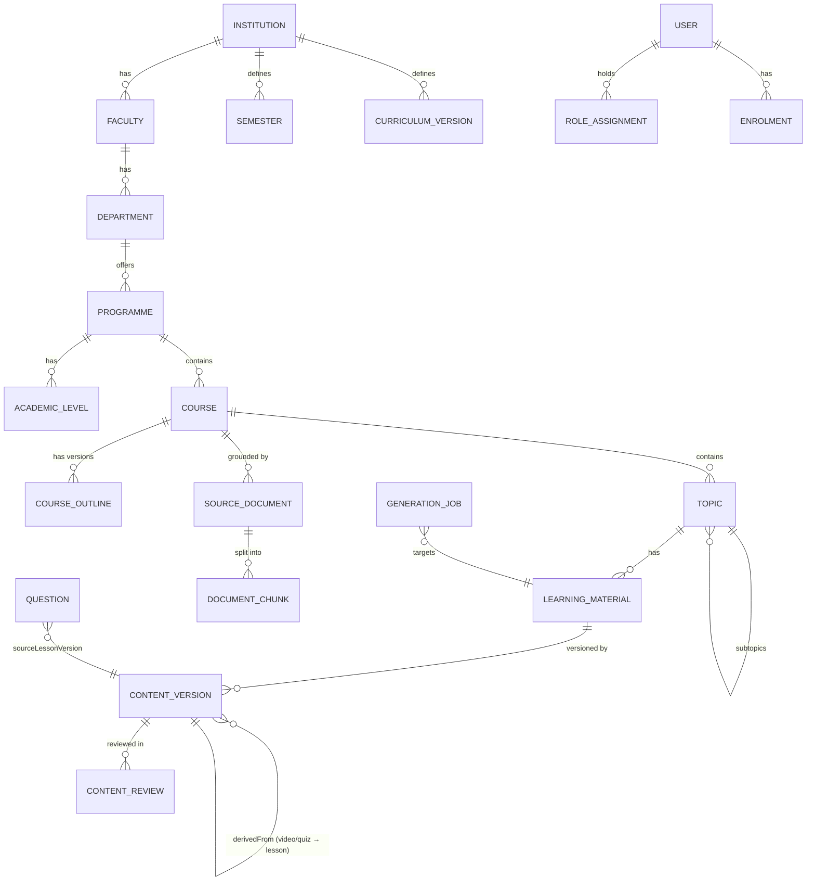

# 02 — Database Design (MongoDB Atlas / Mongoose)

## 1. Conventions

- Every collection has `_id: ObjectId` and `createdAt` / `updatedAt` (Mongoose `timestamps`).
- **Tenant-scoped** collections (marked 🏛) carry `institutionId: ObjectId` (required, indexed). It always comes first in compound indexes.
- Ancestor IDs are **denormalised** down the hierarchy (a topic stores `institutionId`, `departmentId`, `programmeId`, `courseId`). Scope checks and filters then need one lookup instead of a chain. These IDs never change after creation, because entities cannot be moved between institutions.
- Soft lifecycle: academic entities use `archivedAt: Date | null` instead of deletes.
- `createdBy` / `updatedBy: ObjectId(User)` on all editorial documents.
- Large binaries live in object storage. MongoDB stores `MediaAsset` metadata only.
- Ordering uses **fractional index strings** (`orderKey`). Reordering one topic changes one document.
- Optimistic concurrency: mutable editorial documents use `optimisticConcurrency: true` (Mongoose `__v`). Clients send `If-Match` with the version.
- Enums live in `packages/shared-types` and are imported by schemas. Names below are `snake_case` values.

## 2. Entity overview



## 3. Identity & access

### `users`

| Field           | Type                                                                             | Notes                             |
| --------------- | -------------------------------------------------------------------------------- | --------------------------------- |
| email           | string                                                                           | unique, lowercased                |
| passwordHash    | string                                                                           | Argon2id. `select: false`         |
| accountType     | enum `admin \| student`                                                          |                                   |
| status          | enum `invited \| active \| suspended \| deactivated`                             | admins start `invited`            |
| profile         | `{ firstName, lastName, displayName, avatarAssetId? }`                           |                                   |
| mfa             | `{ enabled, totpSecretEnc, recoveryCodeHashes[], enrolledAt }`                   | secret encrypted. `select: false` |
| security        | `{ failedLoginCount, lockedUntil, passwordChangedAt, lastLoginAt, lastLoginIp }` |                                   |
| studentProfile? | `{ institutionId, programmeId, levelId, matricNo? }`                             | students only                     |

Indexes: `{email:1}` unique · `{accountType:1,status:1}` · `{'studentProfile.institutionId':1}`.

### `roleAssignments`

Roles are defined in code as permission bundles (doc 03). Assignments bind a user to a role inside a scope.

| Field                           | Type                                                                            | Notes                                              |
| ------------------------------- | ------------------------------------------------------------------------------- | -------------------------------------------------- |
| userId                          | ObjectId(User)                                                                  |                                                    |
| role                            | enum `super_admin \| institution_admin \| content_manager \| academic_reviewer` |                                                    |
| institutionId                   | ObjectId \| null                                                                | `null` only for `super_admin`                      |
| departmentIds                   | ObjectId[]                                                                      | optional narrower scope. Empty = whole institution |
| grantedBy, grantedAt, revokedAt |                                                                                 |                                                    |

Indexes: `{userId:1, role:1, institutionId:1}` unique (partial: `revokedAt: null`) · `{institutionId:1, role:1}`.

> A `roles` collection is **not** needed in v1. Permissions per role are code constants, which keeps them versioned, reviewable and testable. A `customRoles` collection can come later without breaking assignments.

### `authSessions`

One document per refresh-token family (one login on one device).

| Field                                                         | Type               | Notes                                                  |
| ------------------------------------------------------------- | ------------------ | ------------------------------------------------------ |
| userId                                                        | ObjectId           |                                                        |
| familyId                                                      | string (uuid)      |                                                        |
| currentTokenHash                                              | string             | SHA-256 of the current refresh token                   |
| previousTokenHashes                                           | string[] (last 5)  | if one of these is reused, the whole family is revoked |
| audience                                                      | `admin \| student` |                                                        |
| mfaSatisfiedAt                                                | Date \| null       |                                                        |
| ip, userAgent, lastUsedAt, expiresAt, revokedAt, revokeReason |                    |                                                        |

Indexes: `{userId:1, revokedAt:1}` · `{currentTokenHash:1}` unique · TTL on `expiresAt`.

### `invitations` · `passwordResets`

Token hash, email, role/institution (for invites), expiresAt (TTL), consumedAt.

## 4. Institutions & academic structure

### `institutions`

`name`, `shortName` (e.g. "YABATECH"), `slug` (unique), `country`, `city`, `logoAssetId`, `timezone` (`Africa/Lagos`), `status` (`active|suspended`), `settings: { defaultLocale, aiMonthlyBudgetUsd, videoMonthlyBudgetUsd, studentAiChatEnabled }`, `archivedAt`.
Indexes: `{slug:1}` unique.

### 🏛 `faculties`

`institutionId`, `name`, `code?`, `orderKey`, `archivedAt`.
Indexes: `{institutionId:1, name:1}` unique (partial: not archived).

### 🏛 `departments`

`institutionId`, `facultyId`, `name`, `code` (e.g. "CSC"), `orderKey`, `archivedAt`.
Indexes: `{institutionId:1, code:1}` unique · `{institutionId:1, facultyId:1}`.

### 🏛 `programmes`

`institutionId`, `facultyId`, `departmentId`, `name` ("National Diploma in Computer Science"), `award` (`ND|HND|BSc|PGD|other`), `code`, `durationLevels`, `archivedAt`.
Indexes: `{institutionId:1, departmentId:1, code:1}` unique.

### 🏛 `academicLevels`

Belong to a programme, because ND 1 belongs to ND.
`institutionId`, `programmeId`, `name` ("ND 1"), `code` ("ND1"), `rank` (1, 2 …), `archivedAt`.
Indexes: `{programmeId:1, code:1}` unique · `{programmeId:1, rank:1}`.

### 🏛 `semesters`

Institution-wide term definitions.
`institutionId`, `name` ("First Semester"), `code` ("S1"), `rank`, `archivedAt`.
Indexes: `{institutionId:1, code:1}` unique.

### 🏛 `curriculumVersions`

Tracks curriculum changes (for example, a new NBTE curriculum edition) without overwriting history.
`institutionId`, `programmeId?`, `label` ("2024 Curriculum"), `effectiveFromSession` ("2024/2025"), `isCurrent`, `notes`.

### 🏛 `courses`

| Field                                                                    | Type                                             | Notes                                                        |
| ------------------------------------------------------------------------ | ------------------------------------------------ | ------------------------------------------------------------ |
| institutionId, facultyId, departmentId, programmeId, levelId, semesterId | ObjectId                                         |                                                              |
| curriculumVersionId                                                      | ObjectId?                                        |                                                              |
| code                                                                     | string                                           | as displayed: `"COM 101"`                                    |
| codeNormalized                                                           | string                                           | uppercased, whitespace removed: `"COM101"`                   |
| title                                                                    | string                                           |                                                              |
| creditUnits                                                              | number (0–30)                                    |                                                              |
| description                                                              | string                                           |                                                              |
| objectives                                                               | `{ id, text, source: 'official' \| 'admin' }[]`  | AI never writes `official`                                   |
| prerequisites                                                            | `{ courseId?, text }[]`                          |                                                              |
| references                                                               | `{ citation, url?, isbn?, sourceDocumentId? }[]` |                                                              |
| activeOutlineId                                                          | ObjectId(CourseOutline)?                         |                                                              |
| isDemoData                                                               | boolean                                          | true for seeded demonstration courses. Shown as a banner.    |
| editorial                                                                | `{ reviewStatus, publication }`                  | doc 05 (courses have a lighter lifecycle: draft → published) |
| archivedAt                                                               |                                                  |                                                              |

Indexes:

- `{institutionId:1, programmeId:1, curriculumVersionId:1, codeNormalized:1}` **unique**. The same code can exist in different institutions, programmes or curricula, but not twice in one programme's curriculum.
- `{institutionId:1, levelId:1, semesterId:1}`
- text index on `title`, `code` for admin search.

### 🏛 `courseOutlines`

Versioned. One course has many outlines; `course.activeOutlineId` points to the approved one.

| Field                   | Type                                                                                                                  | Notes                                                            |
| ----------------------- | --------------------------------------------------------------------------------------------------------------------- | ---------------------------------------------------------------- |
| institutionId, courseId |                                                                                                                       |                                                                  |
| version                 | number                                                                                                                |                                                                  |
| origin                  | `manual \| upload \| paste`                                                                                           |                                                                  |
| sourceDocumentId        | ObjectId?                                                                                                             | the original uploaded file, kept forever                         |
| rawText                 | string                                                                                                                | extracted text (capped; the full text stays in storage if large) |
| extraction              | `{ status: pending\|extracting\|suggested\|failed, jobId, suggestedStructure, warnings[] }`                           | AI suggestion, never auto-applied                                |
| structure               | `OutlineNode[]` `{ key, title, kind: 'topic'\|'subtopic', children[], sourceSpan?: {page, start, end}, confidence? }` | what the admin approved                                          |
| status                  | `draft \| approved \| superseded`                                                                                     |                                                                  |
| approvedBy, approvedAt  |                                                                                                                       |                                                                  |

When an outline is approved, topics can be **synced** from it. Sync creates missing topics and flags removed ones. It never deletes topics that have content.

### 🏛 `topics`

Topics and subtopics share one collection (`parentTopicId`).
`institutionId`, `departmentId`, `programmeId`, `courseId`, `parentTopicId?`, `title`, `slug`, `orderKey`, `depth` (0 = topic, 1 = subtopic, max 2), `learningObjectives[] {id,text,source}`, `outlineNodeKey?`, `editorial`, `archivedAt`.
Indexes: `{courseId:1, parentTopicId:1, orderKey:1}` · `{courseId:1, slug:1}` unique.

## 5. Content

### 🏛 `learningMaterials`

A logical piece of content attached to a topic. It holds lifecycle pointers. The content itself lives in versions.

| Field                            | Type                                                                                                                | Notes                                             |
| -------------------------------- | ------------------------------------------------------------------------------------------------------------------- | ------------------------------------------------- |
| institutionId, courseId, topicId |                                                                                                                     |                                                   |
| kind                             | `notes_comprehensive \| notes_simplified \| revision_pack \| quiz \| video \| resource`                             |                                                   |
| locale                           | string (`en-NG`)                                                                                                    |                                                   |
| title                            | string                                                                                                              |                                                   |
| currentDraftVersionId            | ObjectId?                                                                                                           | the editable working version                      |
| latestApprovedVersionId          | ObjectId?                                                                                                           |                                                   |
| publishedVersionId               | ObjectId?                                                                                                           | **the only field student reads follow**           |
| publication                      | `{ state: unpublished\|scheduled\|published\|archived, scheduledFor?, publishedAt?, publishedBy?, unpublishedAt? }` |                                                   |
| displayStatus                    | enum                                                                                                                | derived and stored for list filtering (doc 05 §3) |
| orderKey                         | string                                                                                                              | order within a topic                              |

Indexes: `{topicId:1, kind:1, locale:1}` unique for kinds other than `resource` (partial) · `{institutionId:1, displayStatus:1, updatedAt:-1}` (review queues) · `{courseId:1, 'publication.state':1}`.

### 🏛 `contentVersions`

Immutable after submission. One collection for all kinds; `body` shape depends on `kind` (Mongoose discriminators).

| Field                                        | Type                                                                                                                                                   | Notes                                                              |
| -------------------------------------------- | ------------------------------------------------------------------------------------------------------------------------------------------------------ | ------------------------------------------------------------------ |
| institutionId, materialId, courseId, topicId |                                                                                                                                                        |                                                                    |
| kind                                         | same as material                                                                                                                                       | discriminator key                                                  |
| versionNumber                                | number                                                                                                                                                 | per material, increments                                           |
| parentVersionId                              | ObjectId?                                                                                                                                              | the version this was forked from                                   |
| derivedFrom                                  | `{ versionId, materialKind }?`                                                                                                                         | e.g. a video or quiz → the exact lesson version it came from       |
| origin                                       | `ai_generated \| manual \| ai_assisted_edit \| imported`                                                                                               |                                                                    |
| generationStatus                             | `none \| queued \| generating \| generated \| failed`                                                                                                  |                                                                    |
| reviewStatus                                 | `draft \| in_review \| changes_requested \| approved \| rejected`                                                                                      |                                                                    |
| frozenAt                                     | Date?                                                                                                                                                  | set on submit. Any write after this is rejected by the schema hook |
| body                                         | discriminated (below)                                                                                                                                  |                                                                    |
| renderedHtml                                 | string?                                                                                                                                                | sanitised, produced at approval for text kinds                     |
| provenance                                   | `{ sections: [{ sectionId, type: 'official'\|'source_grounded'\|'ai_supplementary' }], citations: [{ id, chunkId, sourceDocumentId, page?, quote }] }` | doc 06 §5                                                          |
| generation                                   | `{ jobId, promptTemplateKey, promptTemplateVersion, taskKey, provider, model, params }`                                                                | for reproducibility                                                |
| contentHash                                  | string                                                                                                                                                 | SHA-256 of normalised body                                         |
| autosaveRev                                  | number                                                                                                                                                 | incremented on each draft autosave                                 |
| submittedBy/At, approvedBy/At                |                                                                                                                                                        |                                                                    |

Body variants:

- **notes\_*:** `{ doc: ProseMirrorJSON, outline: {sectionId,title}[] , wordCount, readingMinutes }`
- **revision_pack:** `{ keyPoints[], summary, flashcards[{front,back}], faq[{q,a}], checklist[] }`
- **quiz:** `{ questionRefs: [{ questionId, revision }], settings: { shuffle, timeLimitSec?, passMark? } }`
- **video:** `{ config, script: Scene[], audio: {sceneId, assetId, durationMs, alignmentAssetId}[], captionsAssetId, renderAssetId, posterAssetId, durationMs }` (doc 07)
- **resource:** `{ assetId, description, licence }`

Indexes: `{materialId:1, versionNumber:-1}` unique · `{institutionId:1, reviewStatus:1, updatedAt:-1}` · `{'derivedFrom.versionId':1}` (find all videos/quizzes from a lesson version).

### 🏛 `contentCheckpoints`

Autosave history for drafts: `versionId`, `autosaveRev`, `doc` (or a diff), `savedBy`, `createdAt`. TTL 30 days, plus explicit named checkpoints with no TTL. Shown in the editor as "Version history → drafts".

### 🏛 `contentReviews`

`institutionId`, `versionId`, `materialId`, `reviewerId`, `decision` (`approved|changes_requested|rejected`), `checklist: { accuracy, objectivesCovered, ageAppropriate, citationsValid, codeRuns? }`, `comments[] { anchor?: {from,to} | sceneId | questionId, text, resolvedAt }`, `createdAt`.
Index: `{versionId:1, createdAt:-1}`.

### 🏛 `publicationEvents`

Append-only log of every publish, unpublish, rollback and schedule: `materialId | courseId | topicId`, `action`, `fromVersionId`, `toVersionId`, `actorId`, `bundleId?`, `reason`, `at`. Used for rollback UI and analytics.

## 6. Assessment

### 🏛 `questions`

Each approved revision is immutable. Editing creates `revision + 1`.

| Field                            | Type                                                                                        | Notes                                                                    |
| -------------------------------- | ------------------------------------------------------------------------------------------- | ------------------------------------------------------------------------ |
| institutionId, courseId, topicId |                                                                                             |                                                                          |
| lineageId                        | ObjectId                                                                                    | stable across revisions                                                  |
| revision                         | number                                                                                      |                                                                          |
| type                             | `mcq_single \| mcq_multi \| true_false \| fill_gap \| short_answer \| coding`               |                                                                          |
| stem                             | ProseMirror JSON (inline code/math allowed)                                                 |                                                                          |
| options                          | `{ id, text, isCorrect }[]`                                                                 | mcq / true_false                                                         |
| answer                           | `{ accepted: string[], caseSensitive } \| { rubric } \| { language, starterCode, tests[] }` | by type                                                                  |
| explanation                      | string                                                                                      |                                                                          |
| difficulty                       | `easy \| medium \| hard`                                                                    |                                                                          |
| bloomLevel?                      | `remember…create`                                                                           |                                                                          |
| sourceLessonVersionId            | ObjectId(ContentVersion)                                                                    | required for AI-generated questions                                      |
| origin, generation               | as in contentVersions                                                                       |                                                                          |
| reviewStatus                     | `draft \| in_review \| approved \| rejected`                                                |                                                                          |
| dedupe                           | `{ stemHash, embedding? }`                                                                  | doc 06 §8                                                                |
| isOfficialAssessment             | boolean, default false                                                                      | AI questions can never set this to true without explicit reviewer action |

Indexes: `{lineageId:1, revision:-1}` unique · `{topicId:1, reviewStatus:1}` · `{courseId:1, 'dedupe.stemHash':1}` · vector index on `dedupe.embedding` (filter `courseId`).

Quizzes are `learningMaterials` with `kind: 'quiz'`. A quiz version pins exact question revisions, so later edits never change a published quiz.

## 7. Sources & RAG

### 🏛 `sourceDocuments`

| Field                                         | Type                                                                                                     | Notes                                                  |
| --------------------------------------------- | -------------------------------------------------------------------------------------------------------- | ------------------------------------------------------ |
| institutionId, courseId?, departmentId?       |                                                                                                          | scope at which it can be retrieved                     |
| title, authors[], publisher?, year?, edition? |                                                                                                          | used for real citations                                |
| category                                      | `course_outline \| lecture_notes \| textbook_excerpt \| reference \| technical_doc \| other`             |                                                        |
| licence                                       | `{ type: 'institution_owned'\|'licensed'\|'open'\|'fair_use_excerpt', notes, confirmedBy, confirmedAt }` | an upload requires the uploader to confirm the licence |
| assetId                                       | ObjectId(MediaAsset)                                                                                     | original file                                          |
| mimeType, sizeBytes, pageCount, sha256        |                                                                                                          | sha256 prevents duplicate uploads                      |
| processing                                    | `{ status: uploaded\|extracting\|chunking\|embedding\|ready\|failed, jobId, error?, chunkCount }`        |                                                        |
| approvedForGeneration                         | boolean                                                                                                  | only `true` documents are retrieved                    |

### 🏛 `documentChunks`

`institutionId`, `courseId?`, `sourceDocumentId`, `ordinal`, `text`, `tokenCount`, `location: { page?, headingPath[], charStart, charEnd }`, `embedding: number[]` (dimensions fixed per embedding model; the model is recorded in `embeddingModel`), `embeddingModel`.

Atlas Vector Search index `chunks_vector`:

```json
{
  "fields": [
    { "type": "vector", "path": "embedding", "numDimensions": 1536, "similarity": "cosine" },
    { "type": "filter", "path": "institutionId" },
    { "type": "filter", "path": "courseId" },
    { "type": "filter", "path": "sourceDocumentId" },
    { "type": "filter", "path": "embeddingModel" }
  ]
}
```

Every `$vectorSearch` **must** include an `institutionId` filter. This is enforced in `RetrievalService`.

### `mediaAssets` 🏛 (nullable `institutionId` for platform assets)

`storageKey`, `bucket`, `mimeType`, `sizeBytes`, `sha256`, `kind` (`document|image|audio|video|captions|alignment|thumbnail`), `visibility` (`private|public_cdn`), `durationMs?`, `width?/height?`, `createdByJobId?`, `scanStatus` (`pending|clean|infected`).
Private assets are served only through short-lived signed URLs. Published video and images are copied or flagged to `public_cdn` at publish time.

## 8. AI operations

### 🏛 `generationJobs`

Covers both AI generation jobs and video generation jobs (Mongoose discriminator on `type`).

| Field                                                         | Type                                                                                                                                                         | Notes                           |
| ------------------------------------------------------------- | ------------------------------------------------------------------------------------------------------------------------------------------------------------ | ------------------------------- |
| institutionId, courseId?, topicId?, materialId?, versionId?   |                                                                                                                                                              |                                 |
| type                                                          | `outline_extraction \| document_ingest \| notes \| revision_pack \| quiz \| editor_action \| video_script \| video_tts \| video_render \| video_scene_regen` |                                 |
| parentJobId? / batchId?                                       |                                                                                                                                                              | batches and BullMQ flows        |
| dedupeKey                                                     | string                                                                                                                                                       | unique while active (doc 06 §7) |
| idempotencyKey?                                               | string                                                                                                                                                       | from the header                 |
| status                                                        | `queued \| active \| completed \| failed \| cancelled`                                                                                                       |                                 |
| progress                                                      | `{ pct, stage, message }`                                                                                                                                    |                                 |
| input                                                         | object (sanitised parameters, no secrets)                                                                                                                    |                                 |
| resultRef                                                     | `{ versionId?, questionIds?, assetIds? }`                                                                                                                    |                                 |
| attempts, maxAttempts, lastError `{code, message, retryable}` |                                                                                                                                                              |                                 |
| bullJobId, queue                                              |                                                                                                                                                              |                                 |
| cost                                                          | `{ estimatedUsd, actualUsd, currency }`                                                                                                                      |                                 |
| requestedBy, startedAt, finishedAt, durationMs                |                                                                                                                                                              |                                 |

Indexes: `{dedupeKey:1}` unique partial on `status ∈ {queued, active}` · `{institutionId:1, status:1, createdAt:-1}` · `{batchId:1}`.

### 🏛 `aiUsageLedger`

One row per provider call. Append-only.
`institutionId`, `jobId`, `capability` (`text|embedding|tts|avatar|render`), `provider`, `model`, `providerRequestId`, `inputTokens`, `outputTokens`, `characters?`, `seconds?`, `estimatedUsd`, `actualUsd?`, `latencyMs`, `status` (`ok|error`), `errorCode?`, `retry` (n), `at`.
Indexes: `{institutionId:1, at:-1}` · `{jobId:1}`. A daily roll-up job writes `aiUsageDaily { institutionId, date, capability, provider, model, totals }` for dashboards.

### `budgetReservations` 🏛

`institutionId`, `jobId`, `amountUsd`, `period` (`2026-11`), `status` (`reserved|settled|released`). Gives atomic reserve-then-settle accounting (doc 06 §9).

### `promptTemplates`

Versioned prompts: `key` (`notes.comprehensive`), `version`, `system`, `userTemplate`, `outputSchemaRef` (name of a Zod schema in `packages/validation`), `isActive`, `changelog`. Global, with optional `institutionId` overrides.

### 🏛 `pronunciationLexicon`

`institutionId` (null = global), `term` ("SQL"), `say` ("sequel" / "S Q L"), `ipa?`, `caseSensitive`, `notes`. Applied before TTS (doc 07 §6).

## 9. Students (shared with web/mobile; admin reads for analytics)

| Collection          | Key fields                                                                                                                                                     | Indexes                                                             |
| ------------------- | -------------------------------------------------------------------------------------------------------------------------------------------------------------- | ------------------------------------------------------------------- |
| 🏛 `enrolments`      | `studentId, institutionId, courseId, source (self\|admin\|subscription), status, enrolledAt`                                                                   | `{studentId:1, courseId:1}` unique · `{courseId:1, status:1}`       |
| 🏛 `studentProgress` | `studentId, courseId, topicId, materialId, materialVersionId, state (not_started\|in_progress\|completed), percent, lastPositionSec?, timeSpentSec, updatedAt` | `{studentId:1, materialId:1}` unique · `{courseId:1, updatedAt:-1}` |
| 🏛 `quizAttempts`    | `studentId, quizMaterialId, quizVersionId, answers[], score, maxScore, startedAt, submittedAt`                                                                 | `{studentId:1, quizMaterialId:1, startedAt:-1}`                     |
| 🏛 `aiConversations` | `studentId, courseId?, topicId?, title, messageCount, lastMessageAt, retentionUntil`                                                                           | `{studentId:1, lastMessageAt:-1}` · TTL on `retentionUntil`         |
| 🏛 `aiMessages`      | `conversationId, role, content, citations[], tokens, createdAt`                                                                                                | `{conversationId:1, createdAt:1}`                                   |
| `subscriptionPlans` | `code, name, priceMinor, currency (NGN), interval, features[], institutionId?`                                                                                 |                                                                     |
| 🏛 `subscriptions`   | `userId, planId, status, provider (paystack), providerRef, currentPeriodEnd`                                                                                   | `{userId:1, status:1}`                                              |
| 🏛 `payments`        | `userId, subscriptionId?, amountMinor, currency, provider, providerRef (unique), status, rawEventId`                                                           | `{providerRef:1}` unique                                            |
| `notifications`     | `userId, type, title, body, link, readAt, channel (in_app\|email\|push)`                                                                                       | `{userId:1, readAt:1, createdAt:-1}` · TTL 180 days                 |
| `activityEvents` 🏛  | `userId, type (lesson_view, video_play, …), refIds, at` — time-series collection                                                                               | used for active-student metrics                                     |

## 10. Governance

### `auditLogs`

Append-only. The app's database user has insert-only rights on this collection in production (custom Atlas role).
`institutionId?`, `actorId`, `actorRoles[]`, `action` (`course.create`, `material.publish`, `user.role.grant`, …), `target: { type, id }`, `before?`, `after?` (diff, with secrets removed), `requestId`, `ip`, `userAgent`, `at`.
Indexes: `{institutionId:1, at:-1}` · `{'target.type':1, 'target.id':1, at:-1}` · `{actorId:1, at:-1}`.

### `systemSettings`

Key/value with schema per key, versioned: `key` (`ai.routing`, `ai.budgets.global`, `security.passwordPolicy`, `uploads.limits`, `video.defaults`), `value`, `institutionId?`, `updatedBy`, `version`.

Example `ai.routing`:

```json
{
  "notes.comprehensive": {
    "provider": "openai",
    "model": "<configured>",
    "maxOutputTokens": 12000,
    "temperature": 0.3
  },
  "quiz.generate": { "provider": "openai", "model": "<configured>" },
  "embeddings.default": { "provider": "openai", "model": "<configured>", "dimensions": 1536 },
  "tts.default": { "provider": "openai", "voice": "<configured>" }
}
```

## 11. Size and performance notes

- The 16 MB document limit: notes bodies are expected to be under 500 KB. Video scripts store scene text only; audio and frames live in object storage.
- `documentChunks` is the largest collection (about 1–3k chunks per textbook). Embedding arrays are excluded from default projections.
- Admin list views always use indexed filters plus `limit` (max 100) with `skip`. Pages beyond 50 switch to keyset pagination.
