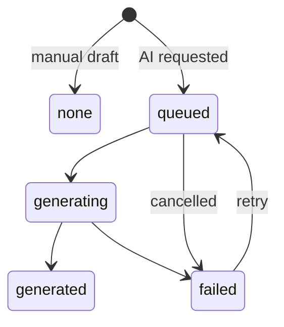
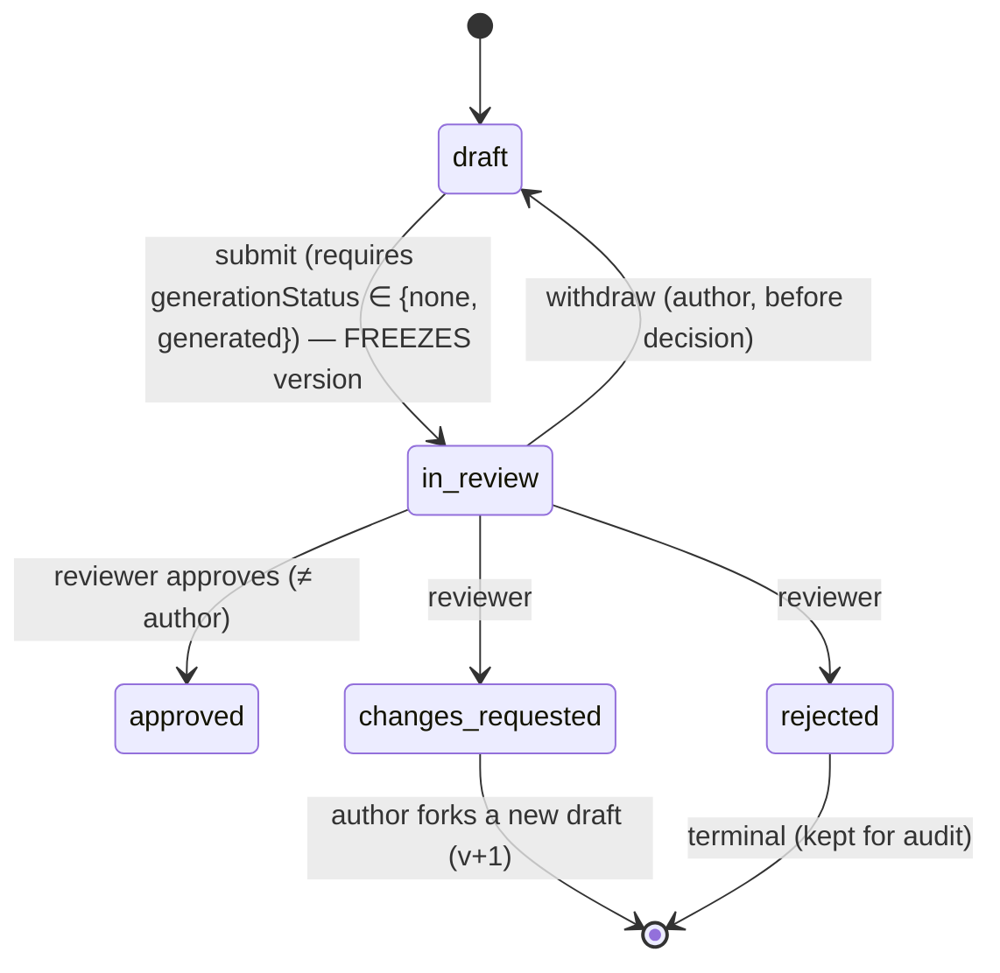
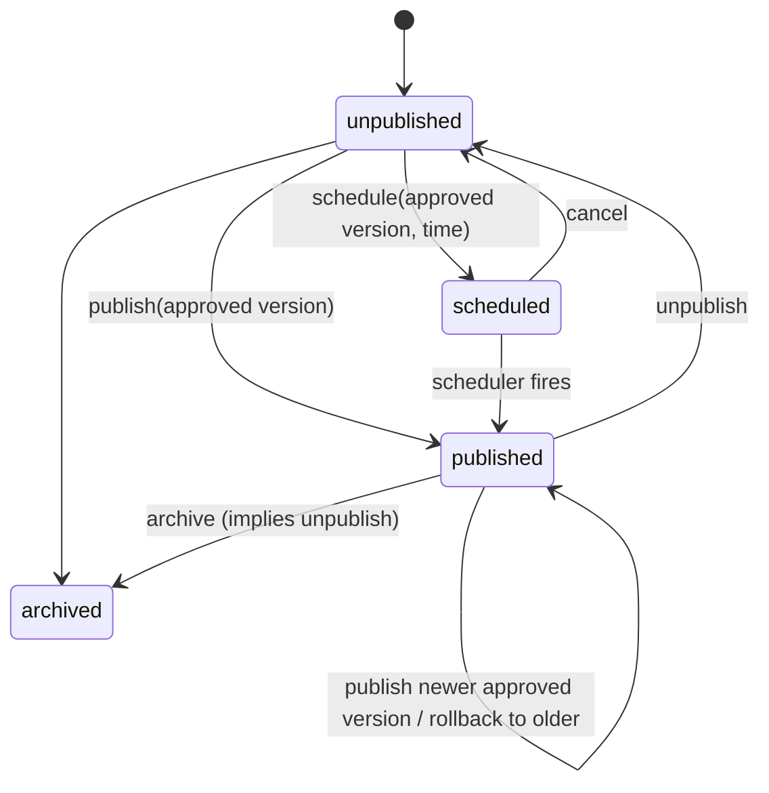

# 05 — Content Lifecycle, Versioning & Publishing

## 1. Three independent state dimensions

The brief's single lifecycle (`Draft → Generating → Generated → In Review → Approved → Published`, plus Rejected / Failed / Archived / Unpublished) is split into three orthogonal fields. A single enum would allow invalid combinations, such as "published while generating".

| Dimension           | Lives on                              | Values                                                                |
| ------------------- | ------------------------------------- | --------------------------------------------------------------------- |
| `generationStatus`  | ContentVersion                        | `none` · `queued` · `generating` · `generated` · `failed`             |
| `reviewStatus`      | ContentVersion                        | `draft` · `in_review` · `changes_requested` · `approved` · `rejected` |
| `publication.state` | LearningMaterial (also Course, Topic) | `unpublished` · `scheduled` · `published` · `archived`                |

A **version** is what gets generated and reviewed. A **material** is what gets published, by pointing at one approved version.

## 2. State machines

### Version: generation



### Version: review



After a version is frozen it is never edited. "Fix and resubmit" means `fork` → new draft version → submit.

### Material: publication



All transitions are implemented in one `TransitionService` with an explicit table. Anything not in the table throws `INVALID_TRANSITION`. Every transition writes an audit log entry.

## 3. Display status (what the UI shows)

Derived and stored as `learningMaterials.displayStatus` for fast filtering. Recomputed on every transition.

| Display                   | Condition                                                   | Badge                    |
| ------------------------- | ----------------------------------------------------------- | ------------------------ |
| Generating                | latest version `generationStatus ∈ {queued, generating}`    | blue, spinner            |
| Failed                    | latest version `generationStatus = failed`                  | red                      |
| Draft                     | latest version `reviewStatus = draft`                       | grey                     |
| In Review                 | latest `in_review`                                          | amber                    |
| Changes requested         | latest `changes_requested`                                  | orange                   |
| Rejected                  | latest `rejected`                                           | red outline              |
| Approved                  | `latestApprovedVersionId` set and not published             | green outline            |
| Published                 | `publication.state = published`                             | solid green              |
| Published · draft pending | published **and** a newer draft or in-review version exists | solid green + amber dot  |
| Scheduled                 | `publication.state = scheduled`                             | purple + date            |
| Unpublished               | was published, now not                                      | grey, strikethrough icon |
| Archived                  |                                                             | muted                    |

## 4. Versioning rules

1. `versionNumber` increments per material. Versions are append-only.
2. **Draft** versions are mutable: autosave writes `body` plus `autosaveRev` under optimistic locking. A checkpoint is stored every 2 minutes or on explicit save (`contentCheckpoints`).
3. `submit-review` sets `frozenAt`, computes `contentHash`, and makes the document immutable. A Mongoose `pre('updateOne'|'findOneAndUpdate'|'save')` hook rejects body changes when `frozenAt` is set. This is a second safety net behind the service layer.
4. Editing a published lesson: `POST /versions/:publishedId/fork` creates a draft `v(n+1)` with `parentVersionId`. The published version keeps serving students.
5. When a newer version is approved, `latestApprovedVersionId` is updated. Publishing it moves `publishedVersionId`. Students see the change atomically.
6. **Rollback** sets `publishedVersionId` to an earlier version that was approved. Nothing is copied or deleted. A `publicationEvents` row records `from` / `to` / `reason`.
7. **Derived content stays pinned.** A video or quiz version records `derivedFrom.versionId`, the exact lesson version used. When a lesson moves to a newer version, the admin UI flags derived items as **"Source updated"** (comparing `derivedFrom.versionId` with the lesson's `publishedVersionId`). The video stays published until someone decides to regenerate it. Nothing changes silently.
8. Approved `renderedHtml` is produced at approval time. It is what students receive, so later changes to the renderer cannot alter published output.

## 5. Publishing rules

`PublishingService` is the **only** code that writes `publishedVersionId` or `publication.*`.

| Rule                                                                                     | Error                                      |
| ---------------------------------------------------------------------------------------- | ------------------------------------------ |
| Target version `reviewStatus = approved`                                                 | `CONTENT_NOT_APPROVED`                     |
| Version belongs to the material                                                          | `CONFLICT`                                 |
| Caller has `content.publish` (or `video.publish`) in the material's institution          | `FORBIDDEN`                                |
| Quiz versions: every pinned question revision is `approved`                              | `CONTENT_NOT_APPROVED` (with question IDs) |
| Video versions: `renderAssetId` and `captionsAssetId` exist and the render job completed | `CONFLICT`                                 |
| Scheduled time must be in the future (≥ 2 minutes)                                       | `VALIDATION_FAILED`                        |

**Partial publishing is allowed.** A topic may have published notes while its video is still in production. No content kind is required.

**Bundles.** `POST /publish-bundles` validates every item first, then applies all pointer changes, the course/topic publication and `publicationEvents` inside one MongoDB transaction (Atlas replica set). It is all-or-nothing.

**Scheduled publishing.** On schedule, write `publication = {state: scheduled, scheduledFor, pendingVersionId}` and add a BullMQ delayed job with `jobId = publish:<materialId>:<versionId>:<ts>`. When the job runs, it re-checks that the version is still approved and the schedule was not cancelled, then publishes. A reconciler (every 5 minutes) publishes any overdue schedules that were missed during an outage.

**Assets on publish.** For videos and images, assets are marked `public_cdn` (or copied to the public bucket prefix). Unpublishing revokes this: the object is moved back to private and the CDN path is purged.

## 6. Cascading visibility

Students can see content only if **every** level is visible:

```
visible(material) = institution.status = active
                 ∧ course.publication.state = published ∧ course.archivedAt = null
                 ∧ topic.publication.state = published (and parent topic, if subtopic)
                 ∧ material.publication.state = published
                 ∧ material.publishedVersionId ≠ null
```

When a course is unpublished, everything under it disappears from the student view, but the children keep their own state. Republishing the course restores the previous state exactly.

## 7. The student read path (leak prevention)

All `/student/*` content endpoints call `PublishedContentQueryService`. This service:

- builds every query from a single `visibleFilter()` helper implementing §6,
- loads version bodies **only** by `publishedVersionId`, never by a client-supplied version ID,
- uses student serializers (`toStudentMaterial`) that list allowed fields explicitly. They never include `generation`, reviewer comments, `currentDraftVersionId`, quiz answers, or internal provenance details beyond the citation list,
- returns `404` (not `403`) for anything hidden, so the existence of drafts is not revealed.

Admin "Preview as student" calls the same serializer with a specified version, so the preview matches exactly what students will see.

**Tests that must exist (doc 08):** for each content kind and each non-published state, the student endpoints return 404 / omit the item; quiz answers never appear in student payloads; a cross-institution student request returns 404.

## 8. Course and topic lifecycle (lighter)

Courses and topics have no versioned bodies. Their metadata edits are audit-logged with before/after diffs. They have `publication.state` only:

- A new course starts **unpublished (draft)**, as the brief requires.
- `course.publish` requires at least one topic. It does **not** require content. An empty published course shows "Content coming soon", which is useful for announcing a curriculum.
- Official course fields (code, objectives marked `official`) can only be changed by humans. AI endpoints have no write path to course or topic metadata.
