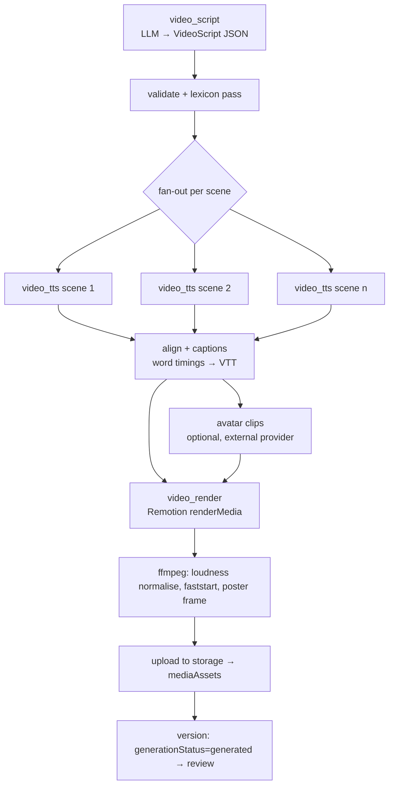

# 07 — AI Video Pipeline

## 1. Principles

- **Deterministic rendering.** Slides, code and text are React components in `packages/video-templates`, rendered by Remotion. Generative models write the _script_ and _narration audio_ only. They never draw text or code into pixels.
- **Pinned source.** A video version records `derivedFrom.versionId`, the approved lesson version it came from (doc 05 §4.7).
- **Scene-level caching.** Each scene's narration audio and visuals are keyed by a content hash. Editing one scene re-synthesises only that scene. Re-rendering reuses everything else.
- **One preview engine.** The admin uses `@remotion/player` with the same compositions, so script edits can be previewed live in the browser **before** paying for TTS or a render.

## 2. Configuration (`VideoConfigSchema`)

```ts
{ title: string; lessonVersionId: ObjectId; learningObjectives: string[];  // default: lesson objectives
  teachingStyle: 'lecture'|'walkthrough'|'story'|'exam_prep';
  voiceId: string; narrationSpeed: number /* 0.8–1.25 */;
  targetDurationSec: number /* 120–1200 */;
  orientation: 'landscape'|'portrait';          // 1920×1080 or 1080×1920
  captions: { burnIn: boolean; sidecarVtt: true };
  themeId: string;                              // from video-templates themes, uses design-tokens
  avatar: { enabled: false } | { enabled: true; provider: string; avatarId: string; placement: 'corner'|'intro_outro' };
  backgroundMusic: { enabled: false } | { enabled: true; trackId: string; volume: number };  // default disabled
  locale: 'en-NG' }
```

## 3. Pipeline as a BullMQ Flow



The parent job tracks progress across stages (`script 10% → tts 40% → captions 50% → render 95% → finalise 100%`) and streams it to `/video-jobs/:id/events` (SSE).

| Stage         | Retries                          | Notes                                                                                              |
| ------------- | -------------------------------- | -------------------------------------------------------------------------------------------------- |
| script        | 2 (with schema-repair feedback)  |                                                                                                    |
| tts per scene | 3, backoff                       | parallelism limited by the provider rate limit                                                     |
| captions      | 2                                |                                                                                                    |
| avatar        | 3, polling with timeout (30 min) | failure → render without avatar + warning, if allowed by config                                    |
| render        | 1 retry                          | `concurrency: 1` per video worker. Remotion `timeoutInMilliseconds` raised. Chromium in the image. |

**Cancellation:** sets a cancel flag. Running stages check it between steps and pass `AbortSignal` / Remotion `cancelSignal`. Stages not yet started are removed from the flow.

**Idempotency:** `dedupeKey = sha256(lessonVersionId + canonical(config) + scriptHash?)`. Pressing "Generate" twice returns the same job.

## 4. Script schema (`VideoScript`)

```ts
{ title; estimatedDurationSec;
  scenes: {
    id: string;                        // stable, used for regeneration and review comments
    purpose: 'hook'|'objectives'|'explain'|'example'|'code_demo'|'recap'|'quiz_prompt'|'outro';
    narration: string;                 // spoken text, ≤ ~120 words per scene
    visual:
      | { type:'title'; heading; subheading? }
      | { type:'bullets'; heading; bullets: string[]; revealOnWords?: string[] }   // revealed in sync with narration
      | { type:'code'; language; code; highlightSteps: { lines: [number,number]; atWord: string }[] }
      | { type:'diagram'; mermaid: string } | { type:'table'; header; rows }
      | { type:'definition'; term; definition } | { type:'comparison'; left; right }
      | { type:'image'; assetId; alt }            // only admin-uploaded / licensed images
      | { type:'quiz'; question; options; answerRevealAfterSec };
    sourceSectionIds: string[];        // lesson sections this scene teaches (validated against derivedFrom version)
  }[] }
```

Validation: total narration words ÷ (150 wpm × speed) ≈ target ±25%; code blocks must appear verbatim in the lesson or be flagged "new code" for the reviewer; every scene maps to at least one lesson section; diagram Mermaid must parse.

## 5. Rendering

- `packages/video-templates` exports `LessonVideo` (a composition that takes `{ config, scenes, audio[], captions }` as input props) plus scene components: `TitleScene`, `BulletsScene`, `CodeScene` (Shiki-highlighted, line highlights and typing animation driven by word timestamps), `DiagramScene` (Mermaid → SVG pre-rendered in the worker, then animated), `QuizScene`, `CaptionsOverlay`, `AvatarOverlay`.
- Scene duration = narration audio duration + padding. All timing comes from audio, so sync is exact.
- Worker: `bundle()` once per template version (cached), `selectComposition()`, `renderMedia({ codec: 'h264', crf: 20 })`.
- FFmpeg post-processing: EBU R128 loudness normalisation (−16 LUFS), `+faststart`, poster frame at 3s, optional 720p rendition. HLS is a later optimisation if mobile data cost requires it.
- Output assets: `video.mp4`, `captions.vtt`, `poster.jpg`, `alignment.json`.
- Scale path: replace `LocalRemotionRenderer` with `LambdaRemotionRenderer` (same `VideoRenderer` interface) when the render queue backs up.

## 6. Narration, pronunciation and captions

1. **Lexicon pass.** Before TTS, `pronunciationLexicon` (institution entries override global ones) rewrites spoken text only. Example: `SQL → "sequel"`, `RAM → "ram"`, `GUI → "gooey"`, `YABATECH → "Yaba Tech"`, `COM 101 → "C O M one-oh-one"`. Caption text keeps the original spelling.
2. **Synthesis** per scene. The audio hash = `sha256(spokenText + voiceId + speed + provider/model)`. Audio is reused if the hash matches.
3. **Alignment.** Use word timings from the TTS provider if it returns them. Otherwise run a speech-to-text alignment pass (word timestamps), then map back onto the _original_ caption text.
4. **Captions** are built from the timings: ≤ 42 characters per line, ≤ 2 lines, 1–7s per cue. Stored as VTT, editable in the review UI. Edited captions are saved without re-synthesising audio.
5. **Fixing a pronunciation issue** in review: the reviewer clicks a word → "Fix pronunciation" → adds a lexicon entry (scoped to this video or the institution) → regenerates the affected scenes' narration only.

## 7. Review UI (Video Studio → Review)

Layout: player (left, scene markers on the timeline) · script/scene list (right) · captions tab · checklist.

Actions, all in-portal:

| Action                                                    | Effect                                                                        |
| --------------------------------------------------------- | ----------------------------------------------------------------------------- |
| Watch / scrub by scene                                    | —                                                                             |
| Comment on a scene or timestamp                           | `contentReviews.comments[].anchor = { sceneId, atMs }`                        |
| Edit scene text / visuals                                 | allowed on a **draft** video version (fork if frozen) → live Player preview   |
| Regenerate narration (scene or all)                       | `video_scene_regen` job, parts: `narration`                                   |
| Regenerate visuals of a scene (LLM rewrite of that scene) | parts: `visuals`                                                              |
| Edit captions                                             | saves a new VTT asset                                                         |
| Re-render                                                 | `video_render` with cached scenes                                             |
| Submit for review / Approve / Request changes / Reject    | shared review endpoints (author ≠ approver)                                   |
| Publish                                                   | `video.publish`. Marks assets `public_cdn`, available through the student API |

## 8. Avatar providers (optional)

`AvatarProvider` interface with adapters `heygen` and `synthesia`, chosen in settings. Avatar clips are generated **from our TTS audio** where the provider supports audio input, so voice stays consistent and the presenter is composited as an overlay. Slides and code are still rendered by Remotion. Avatar spend has its own budget line. Ships after the core pipeline is stable (Phase 4b).

## 9. Cost model (per video, tracked in the ledger)

`script tokens` + `TTS characters` + `alignment seconds` + `render compute seconds` (estimated from worker time × instance price) + `avatar seconds`. Shown as an estimate before "Generate" and as actual cost on the job page.
